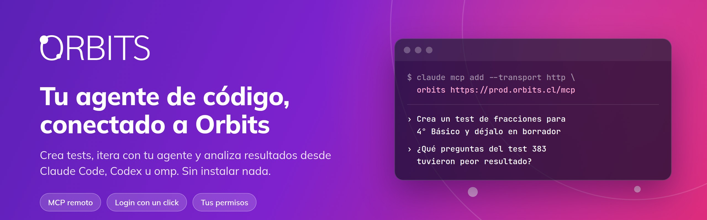
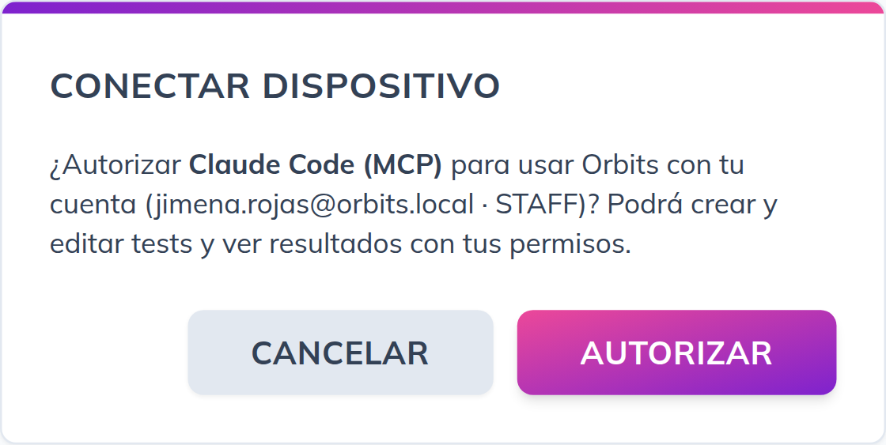
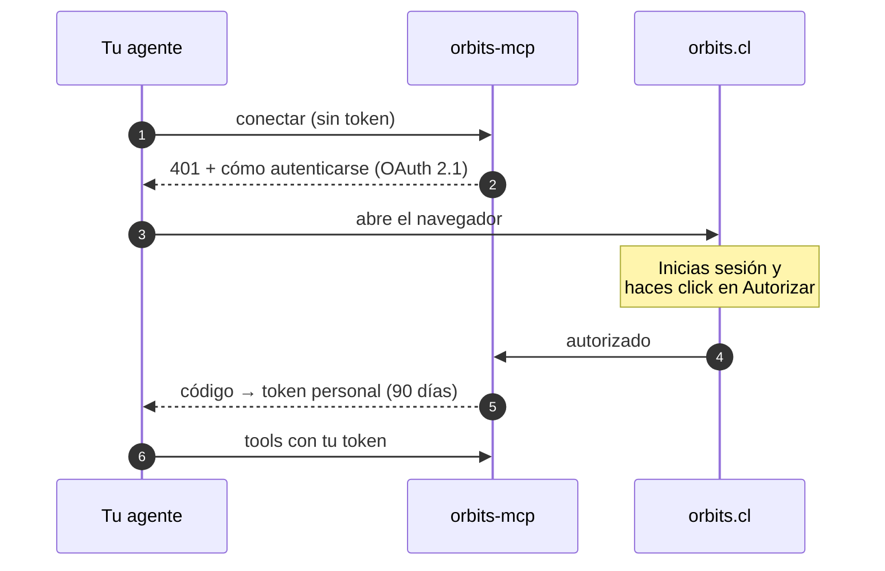

<p align="center">
  
</p>

<p align="center">
  <a href="https://github.com/osc-ltda/orbit-mcp/actions/workflows/image.yml"></a>
  <a href="LICENSE"></a>
  <a href="https://modelcontextprotocol.io/specification/2026-07-28"></a>
  
</p>

<p align="center">
  <b>Crea tests, itera con tu agente y analiza resultados de <a href="https://orbits.cl">Orbits</a><br>desde Claude Code, Codex, omp o cualquier cliente MCP.</b>
</p>

<p align="center">
  <a href="#-conéctalo-en-30-segundos">Conectar</a> ·
  <a href="#-qué-puedes-hacer">Qué puedes hacer</a> ·
  <a href="#-cómo-funciona-el-login">Login y seguridad</a> ·
  <a href="#-correrlo-localmente">Modo local</a>
</p>

---

## ✨ Por qué

Armar una evaluación en Orbits es redactar preguntas, ajustar alternativas, revisar, subir y publicar. Con **orbits-mcp**, ese trabajo lo hace tu agente de código, con tus permisos y sin salir de la terminal:

- **Sin instalar nada.** Es un servidor MCP remoto en `https://prod.orbits.cl/mcp`.
- **Login con un click.** El agente abre Orbits en el navegador y tú autorizas. Tu contraseña nunca pasa por el agente.
- **Seguro por defecto.** Todo lo que el agente crea queda como **borrador** y solo se publica cuando tú lo pides.
- **Análisis real.** Usa las mismas estadísticas del panel de monitoreo: notas, distribución de puntajes, % de acierto por pregunta y alternativas más elegidas.

## 🚀 Conéctalo en 30 segundos

<details open>
<summary><b>Claude Code</b></summary>

```sh
claude mcp add --transport http --scope user orbits https://prod.orbits.cl/mcp
```

Después, en Claude Code: `/mcp` → `orbits` → **Authenticate**.

Con `--scope project` se guarda en un `.mcp.json` del proyecto que puedes commitear para tu equipo.
</details>

<details>
<summary><b>Codex</b></summary>

```sh
codex mcp add orbits --url https://prod.orbits.cl/mcp
codex mcp login orbits
```

También puedes agregarlo a mano en `~/.codex/config.toml`:

```toml
[mcp_servers.orbits]
url = "https://prod.orbits.cl/mcp"
```
</details>

<details>
<summary><b>omp</b></summary>

Créalo en `.omp/mcp.json` (solo en ese proyecto) o en `~/.omp/agent/mcp.json` (en todos):

```json
{
  "mcpServers": {
    "orbits": { "type": "http", "url": "https://prod.orbits.cl/mcp" }
  }
}
```

Después, escribe `/mcp` en omp. omp también lee la configuración de Claude Code y Codex: si ya lo agregaste ahí con alcance de usuario, no tienes que hacer nada más.
</details>

<details>
<summary><b>Cursor, VS Code, Claude Desktop y otros</b></summary>

Agrega un servidor MCP remoto (HTTP) con la URL `https://prod.orbits.cl/mcp`. El cliente detecta el login OAuth automáticamente.
</details>

La primera vez se abre Orbits en el navegador. Revisa qué cliente pide acceso y autoriza:

<p align="center">
  
</p>

## 💬 Qué puedes hacer

Habla con tu agente como lo harías con un colega:

| Pídele… | Qué hace |
|---|---|
| *"Crea un test de 12 preguntas de fracciones para Matemática 4° Básico, con dos niveles de dificultad"* | Lee el formato, revisa los temas del curso y crea el test como **borrador** |
| *"Exporta el test 383, cambia las preguntas ambiguas y vuelve a subirlo"* | Exporta, edita el `test.json` y lo reimporta |
| *"¿Qué preguntas del test 383 tuvieron peor resultado y qué alternativa incorrecta eligieron más?"* | Análisis por pregunta con la distribución de respuestas |
| *"Resume cómo va el curso: promedios por test y quiénes no han rendido"* | Resumen del curso a partir del monitoreo |
| *"Publica el test 383"* | Lo hace visible para los alumnos. Solo si lo pides, y tu cliente te pide confirmar |

Si el test tiene errores, Orbits responde con cada problema y su ubicación (`questionSets[0].questionsToShow: …`). El agente los corrige y vuelve a intentarlo solo.

<details>
<summary><b>Todas las tools</b></summary>

| Tool | Tipo | Descripción |
|---|---|---|
| `whoami` | lectura | Usuario, rol y URL |
| `list_courses`, `course_topics` | lectura | Cursos y temas |
| `list_tests`, `get_test`, `export_test` | lectura | Tests, preguntas con solución y bundle exportable |
| `test_results`, `course_results`, `student_results`, `tag_summary`, `list_attempts` | lectura | Resultados y estadísticas |
| `import_test`, `append_questions` | escritura | Crea un test (borrador) o agrega preguntas; imágenes en base64 |
| `set_test_published` | destructiva | Publica o despublica un test |

Recurso: `orbits://docs/import-format`, con el formato completo de `test.json`.
</details>

## 🔐 Cómo funciona el login



- **Tus permisos, no más.** El agente actúa como tú: un profe ve los cursos donde tiene rol, y un admin, todo.
- **Revocable.** Cada conexión es un token personal que aparece en tu perfil, en **Tokens de acceso**. Si lo revocas, el agente pierde el acceso de inmediato.
- **Sin contraseñas en el agente.** El login ocurre siempre en orbits.cl.
- **El servidor no toca archivos.** En modo remoto las imágenes viajan como contenido (base64) y no hay acceso al disco del servidor.

## 💻 Correrlo localmente

Esta opción sirve para desarrollo, o para que el servidor lea imágenes directamente de tu disco (`image_paths`). Requiere [uv](https://docs.astral.sh/uv/).

```sh
claude mcp add orbits -- uvx --from git+https://github.com/osc-ltda/orbit-mcp orbits-mcp
uvx --from git+https://github.com/osc-ltda/orbit-mcp orbits-mcp login   # abre el navegador; guarda el token en ~/.config/orbits
```

| Variable | Uso |
|---|---|
| `ORBITS_URL` | URL de la API (por defecto `https://prod.orbits.cl/api/v1`) |
| `ORBITS_TOKEN` | Token personal `orb_...`, para CI o máquinas sin navegador |

## 🛠️ Desarrollo

```sh
uv run pytest
uv run orbits-mcp --help
MCP_SECRET=dev MCP_PUBLIC_URL=http://localhost:8000 uv run orbits-mcp serve-http   # modo remoto (OAuth)
```

Hecho con [FastMCP](https://gofastmcp.com) sobre la API REST de Orbits. Cada push a `main` publica la imagen `ghcr.io/osc-ltda/orbit-mcp:sha-<commit>`, y producción se despliega desde [orbit-ops](https://github.com/osc-ltda/orbit-ops).

## 📄 Licencia

[GPL-3.0](LICENSE): úsalo libremente. Si distribuyes una versión modificada, comparte su código bajo la misma licencia.
